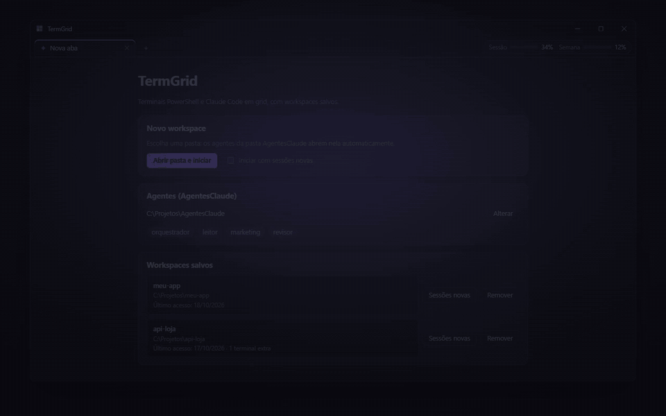
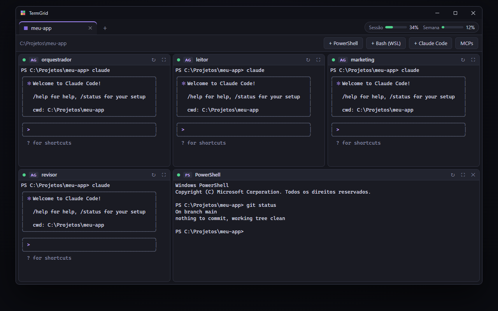

<div align="center">


# TermGrid

**Seus terminais PowerShell e Claude Code em grid, com workspaces e abas, num app nativo para Windows.**

Abra uma pasta e o TermGrid sobe toda a sua equipe de agentes do Claude Code lado a lado, retomando as sessões de onde pararam.

[](https://github.com/JoseDaniloS/TermGrid/releases/latest)
&nbsp;

&nbsp;




<sub>Demonstração animada da interface, com dados fictícios.</sub><br/>
<sub>🎬 Demo em alta qualidade: [docs/demo.mp4](docs/demo.mp4)</sub>

</div>

---

## ✨ Por que o TermGrid?

Trabalhar com vários agentes do Claude Code (um orquestrador, um leitor, um revisor…) significa abrir um monte de janelas, apontar cada uma para a pasta certa e lembrar qual sessão retomar. O TermGrid resolve isso:

- 🧩 **Terminais em grid redimensionável.** Os painéis se organizam sozinhos, e você arrasta as divisórias com o mouse para ajustar. Duplo clique numa divisória iguala os tamanhos, e o botão de maximizar amplia um painel. Cada terminal também pode ocupar 2 colunas e/ou 2 linhas, pelos botões de largura e altura dupla ou arrastando o canto inferior direito do painel.
- 🗂️ **Workspaces salvos.** Cada pasta vira um workspace que guarda os terminais extras, o layout do grid e as abas abertas. Ao reabrir o app, tudo volta do jeito que estava.
- 🤖 **Os agentes abrem sozinhos.** Ao iniciar um workspace, cada agente da sua pasta `AgentesClaude` sobe no seu painel, retomando a sessão anterior daquela pasta (ou com sessões novas, se você preferir).
- 🌐 **Abas como num navegador.** Adicione, feche (inclusive com o clique do meio), renomeie com duplo clique e alterne entre os workspaces.
- 🎛️ **Controles em cada painel.** Compactar a sessão do Claude (`/compact`), reiniciar, encerrar um agente (ele volta ao reabrir o workspace, retomando a sessão) ou fechar um terminal extra.
- ➕ **Terminais extras**, como PowerShell, Bash (WSL) ou um Claude Code avulso, cuja sessão também é retomada.
- 🟢 **Saúde dos agentes.** Cada painel de agente mostra se o Claude está conectado. Quando um agente cai, o app tenta reconectá-lo até 6 vezes, com intervalos crescentes; depois disso, basta clicar em reiniciar.
- 📊 **Medidor de uso do plano.** Mostra o uso da sessão de 5 h e o semanal (todos os modelos, Opus e Sonnet), com o tempo até redefinir.
- 🔌 **Painel de MCPs.** Lista os servidores MCP globais, do projeto, dos conectores claude.ai e dos plugins, com o status de cada um.
- 📋 **Copiar e colar como no Windows Terminal.** Ctrl+C copia o texto selecionado, Ctrl+V cola (sem texto na área de transferência, repassa o Ctrl+V para o Claude colar imagens) e o botão direito copia ou cola.

<div align="center">
  
</div>

## 📥 Instalação

1. Baixe o instalador `TermGrid_x.y.z_x64-setup.exe` na página de [**Releases**](https://github.com/JoseDaniloS/TermGrid/releases/latest).
2. Execute o instalador. Ele não pede administrador e instala só para o seu usuário.
3. Abra o **TermGrid** pelo Menu Iniciar.

> O Windows SmartScreen pode avisar que o app é de um editor desconhecido, porque o executável não tem assinatura digital. Clique em **Mais informações → Executar assim mesmo**.

### Requisitos

| Requisito | Para quê |
|---|---|
| Windows 10/11 x64 com **WebView2** (já vem no Windows 11) | Interface do app |
| **Windows PowerShell** | Todos os terminais |
| **[Claude Code](https://docs.claude.com/claude-code)** 2.1.234+ com instalação nativa (`claude.exe` no PATH) | Agentes, painel Claude Code, painel de MCPs e monitor de saúde |
| **WSL** (opcional) | Painéis "Bash (WSL)" |
| Pasta **AgentesClaude** (já vem no instalador) | Agentes abertos automaticamente em cada workspace |

## 🤖 Pasta AgentesClaude

O TermGrid já vem com uma equipe pronta: **orquestrador**, **leitor** e **revisor**. Ela fica em [`examples/AgentesClaude`](examples/AgentesClaude).

- Se você já tem uma pasta `AgentesClaude` na Área de Trabalho (inclusive na do OneDrive), o app usa a sua.
- Se não tem, a equipe embutida é copiada na primeira execução para `%APPDATA%\dev.termgrid.desktop\AgentesClaude`, onde você pode editar as instruções e as permissões à vontade. Atualizações do app nunca sobrescrevem essa cópia; para receber o kit de uma versão nova, renomeie a pasta e reabra o app.
- Na tela inicial dá para escolher outra pasta.

A estrutura é esta:

```
AgentesClaude/
├── IniciarSessoes.ps1          # script que abre a sessão de cada papel
└── agentes/
    ├── orquestrador/           # sempre o primeiro painel
    └── subagentes/
        ├── leitor/             # cada subpasta vira um painel
        └── revisor/
```

Só viram painéis as subpastas cujo nome tem apenas letras, números, `-` e `_` (sem começar com `-`); as outras são ignoradas.

Cada papel tem:

| Arquivo | Conteúdo |
|---|---|
| `instrucoes.md` | Prompt do agente (adicionado com `--append-system-prompt`) |
| `modelo.txt` | Modelo: `opus`, `sonnet` ou `haiku` |
| `tools-permitidas.txt` / `tools-bloqueadas.txt` | Ferramentas liberadas e bloqueadas (orquestrador) |
| `tools.txt` | Ferramentas liberadas (subagentes); `Bash` fica restrito a `git status/diff/log` |
| `bash-permitidos.txt` | Comandos Bash extras liberados (opcional) |

Para adicionar um agente, crie uma subpasta nova em `agentes\subagentes\`. Ela vira um painel no próximo workspace que você abrir. As sessões conversam entre si com `ListAgents` e `SendMessage`.

O `IniciarSessoes.bat` também funciona fora do TermGrid: arraste uma pasta sobre ele para abrir a equipe no Windows Terminal.

Para cada papel, o TermGrid executa:

```powershell
powershell -NoExit -NoProfile -ExecutionPolicy Bypass -File IniciarSessoes.ps1 -Papel <papel> -Pasta <pasta-do-workspace> [-Nova]
```

É o script que define o modelo, o prompt e as permissões de cada agente, e que guarda o ID da sessão por pasta em `sessoes\` para o `--resume`. A opção **"Iniciar com sessões novas"** passa `-Nova` apenas na primeira execução de cada painel. Reiniciar um painel depois disso retoma a sessão que acabou de ser criada.

O TermGrid também passa a variável de ambiente `CLAUDE_EQUIPE`, um identificador curto por workspace. O script do kit a usa no nome das sessões (ex.: `leitor-1a2b`), para que duas equipes abertas ao mesmo tempo nunca tenham sessões com o mesmo nome no `SendMessage`.

## ⌨️ Atalhos

| Atalho | Ação |
|---|---|
| `Ctrl+Shift+T` | Nova aba |
| `Ctrl+Shift+W` | Fechar aba |
| `Ctrl+Tab` / `Ctrl+Shift+Tab` | Próxima / aba anterior |
| `Ctrl+PageDown` / `Ctrl+PageUp` | Próxima / aba anterior |
| `Ctrl+C` (com seleção) ou `Ctrl+Shift+C` | Copiar |
| `Ctrl+V` | Colar |
| Botão direito no terminal | Copiar a seleção ou colar |
| Duplo clique no cabeçalho do painel | Maximizar ou restaurar |
| Duplo clique na divisória | Igualar os tamanhos |
| Duplo clique na aba | Renomear o workspace |
| `Enter` num processo encerrado | Reiniciar o terminal |

## 🔒 Privacidade

- Os workspaces, o layout e as abas ficam em `%APPDATA%\dev.termgrid.desktop\state.json`, só no seu computador.
- O **medidor de uso** lê o token OAuth local do Claude Code (`%USERPROFILE%\.claude\.credentials.json`) e o envia **somente** para `https://api.anthropic.com/api/oauth/usage`, para consultar o uso do seu plano. O token não passa pela interface, não é gravado em lugar nenhum e não é renovado pelo app.
  > ⚠️ Esse é um endpoint **interno e não documentado** da Anthropic (o mesmo que o Claude Code usa). Ele pode mudar ou deixar de funcionar sem aviso, e os termos da Anthropic restringem o uso do token de assinatura fora dos produtos oficiais. Use por sua conta e risco.
- O **painel de MCPs** lê `~/.claude.json` e o `.mcp.json` da pasta (apenas o nome, o tipo e o destino de cada servidor; variáveis de ambiente e cabeçalhos não são lidos) e executa `claude mcp list`.
- O **monitor de saúde** lê apenas os nomes dos arquivos em `~/.claude/sessions` e a lista de processos do Windows, e verifica em `~/.claude/projects` se uma sessão pode ser retomada. Nada disso sai do computador.
- Não há telemetria.

## 🛠️ Compilar a partir do código

Pré-requisitos: [Node.js](https://nodejs.org) 18+, [Rust](https://rustup.rs) (toolchain MSVC) e as [Build Tools do Visual Studio](https://visualstudio.microsoft.com/visual-cpp-build-tools/) com o Windows SDK.

```bash
git clone https://github.com/JoseDaniloS/TermGrid.git
cd TermGrid
npm install
npm run tauri dev      # modo de desenvolvimento
npm run tauri build    # gera o .exe e o instalador em src-tauri/target/release/bundle/nsis
```

## 🧱 Arquitetura

```
src/                         # Frontend (JS vanilla + xterm.js, componentes por composição)
├── components/
│   ├── App.js               # abas + views; atalhos globais
│   ├── TabBar.js            # barra de abas estilo navegador
│   ├── HomeView.js          # tela "Nova aba": abrir pasta, workspaces salvos
│   ├── WorkspaceView.js     # agentes + terminais extras de um workspace
│   ├── TerminalGrid.js      # grid com divisórias arrastáveis e spans por painel
│   ├── gridLayout.js        # posicionamento dos painéis no grid (sem DOM)
│   ├── TerminalPane.js      # painel com xterm ligado a um PTY
│   ├── UsageMeter.js        # medidor de uso do plano
│   ├── McpPanel.js          # lista de servidores MCP
│   └── Modal.js             # janela modal reutilizável
└── lib/                     # api (ponte Tauri), store (persistência), agentMonitor, dom, icons

src-tauri/src/               # Backend em Rust
├── pty.rs                   # pseudo-terminais via ConPTY (portable-pty)
├── panes.rs                 # tipo de painel → comando (com validação)
├── agents.rs                # descoberta da pasta AgentesClaude e dos papéis
├── health.rs                # saúde dos agentes (árvore de processos)
├── mcp.rs                   # MCPs configurados e status
├── usage.rs                 # uso do plano (API da Anthropic)
└── state.rs                 # state.json com escrita atômica
```

Os terminais são pseudo-consoles reais do Windows (ConPTY), então o Claude Code, o PowerShell e qualquer outro programa de terminal rodam com cores e com a interface de texto completa. Ao fechar uma aba ou o app, a árvore de processos de cada terminal é encerrada.

## 📄 Licença

[MIT](LICENSE) © TermGrid contributors
